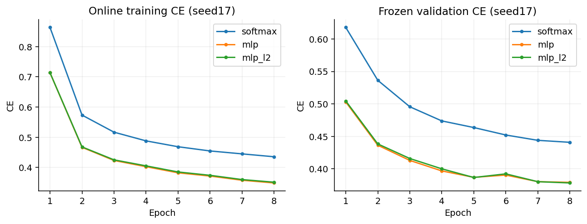

# TraceGrad

[](https://github.com/whx360/TraceGrad/actions/workflows/ci.yml)

**A small CPU autodiff engine with transparent numerical contracts and reproducible experiments.**

自实现张量计算图、反向传播、广播梯度、SGD/Adam和训练流程，核验梯度正确性、真实分类任务与相同数学计算的实际代价。

NumPy/BLAS provides arrays and matrix multiplication. TraceGrad implements graph construction, local VJPs, traversal, accumulation, graph lifetime, models, optimizers and experiment control. PyTorch is an independent numerical reference, not the training backend. Implementation and documentation were developed with AI assistance; standard algorithms are attributed below.

## Quick start

Python3.10+; local records use Python3.12 on Windows.

```bash
git clone https://github.com/whx360/TraceGrad.git
cd TraceGrad
python -m venv .venv
# Windows: .venv\Scripts\activate
# Linux/macOS: source .venv/bin/activate
python -m pip install -e ".[experiment]"
python run.py demo
python run.py test
```

`demo` downloads nothing: it verifies a hand-computable gradient and learns XOR using the engine's own layers and Adam. This synthetic fixture checks functionality, not real-data generalization.

For independent PyTorch verification:

```bash
python -m pip install torch --index-url https://download.pytorch.org/whl/cpu
python run.py verify
```

The recorded suite has85tests with zero failures/errors/skips. Without PyTorch, `test` explicitly skips its independent reference case; `verify` requires it. Tests cover central differences, analytic cases, broadcasting, shared graphs, lifecycle, extreme values, corrupt inputs, optimizer state and training/export. CI runs dataset-free checks on Ubuntu and Windows; use the live badge for current status.

## Minimal API

```python
from tracegrad import Tensor
x = Tensor([1., 2., 3.], requires_grad=True)
loss = (x * x).sum()
loss.backward()
print(loss.item())  # 14.0
print(x.grad)       # [2., 4., 6.]
```

```text
finite arrays -> Tensor operators -> dynamic DAG -> reverse-topological VJPs
                                                             |
                                                   parameter leaf gradients
                                                             |
                                                        SGD / Adam
                                                             |
                                  validation selection -> frozen evaluation
```

## Numerical and lifecycle contracts

- float32/float64, scalars and nonempty arrays; 2-D matrix multiplication.
- NumPy-style elementwise broadcasting; backward reduces expanded axes.
- Scalar backward defaults to seed1; nonscalar outputs require a matching seed.
- Leaf gradients accumulate; intermediate cotangents are fresh on each pass.
- Backward releases graph edges by default; reuse requires `retain_graph=True`.
- Public data is read-only; version checks reject stale forward operands.
- Stable log-sum-exp and fused CE; ReLU derivative0 at0.
- Explicit L2 `lambda/2 * sum(weight**2)`, excluding bias; no hidden optimizer decay.

No higher derivatives, general in-place operators, GPU kernels, convolutions or framework-equivalent compatibility are claimed. Inference NPZ files are not full resume checkpoints.

## Recorded experiments

Fixed Fashion-MNIST protocol:54000train/6000validation/10000officialtest; seeds17/29/43;8epochs,batch256,Adam lr0.001. Epoch and primary-variant selection use validationCE only. Every fixed configuration's test result is retained.

| Model | Test accuracy, mean ± sample std | Test macro-F1 | Test CE |
|---|---:|---:|---:|
| Linear Softmax |83.480% ±0.202 percentage points|0.833431|0.472524|
|784→64→10 ReLU MLP|86.090% ±0.114 percentage points|0.860119|0.397045|
|Same MLP,L2=1e-4|85.927% ±0.060 percentage points|0.858358|0.399736|

L2 did not improve these fixed-budget results. Three seeds describe variation, not significance. [Protocol and interpretation](docs/experiments.md), [raw summary](benchmarks/reference/classification_runs.csv).



## Performance evidence

Profiling exposed an avoidable matrix product: the eagerVJP computed input gradients for images with `requires_grad=False`. Selective parentVJPs reduced fixedMLP forward/backward median **1.68663→1.06237ms(1.5876×)** with matching loss and all parameter gradients.

Four float64 CE shapes measured **2.2602–3.5826×** for fused versus the declared stable composition. The256×100 case reduced graphnodes12→2 and retained graph-arraybytes1,034,272→411,656.

Fixed CPU microbenchmarks:one BLASthread,15paired samples,10innercalls/sample. MLP excludes optimizer updates, data loading and validation. Graph-arraybytes are not process peakRSS. No whole-training or PyTorch speed advantage is claimed. [Raw samples](benchmarks/reference/performance_samples.csv), [structured results](benchmarks/reference/performance.json).

## Reproduce

```bash
python run.py fetch
python run.py experiment --quick
python run.py experiment
python run.py benchmark
python run.py report
```

Datasets, trained models, runtime artifacts and generated reports are ignored. Nonempty experiment outputs are rejected; use `--output results/reproduction_01` for another run. Quick runs are smoke-only. `report` reads canonical `results/formal_v1`; run `verify` before it. Source URLs, author checksums and split identities are in [data provenance](benchmarks/reference/data_sources.json).

## Repository map

```text
src/tracegrad/       autodiff, models, optimizers, data, training, benchmarks
tests/              mathematical, numerical, state and integration checks
configs/            fixed experiment protocol
benchmarks/reference/ measured records, environment and provenance
docs/               architecture, numerics and experiment analysis
assets/             figures generated from recorded experiments
.github/workflows/  dataset-free cross-platform checks
```

[Architecture](docs/architecture.md) · [Numerics and tests](docs/numerics.md) · [Experiments](docs/experiments.md) · [Sources](docs/references.md)

MIT applies to this code. Dataset and dependency terms remain separate.
